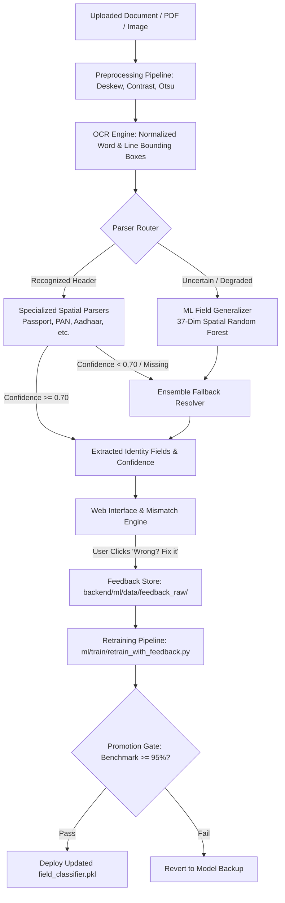

# Sahayak (SmartApply) — Intelligent Document Verification Assistant

> **Indian Government Document Verification & Statutory Portal Guidance System**  
> Streamlining citizen document preparation for Passport, Aadhaar, PAN, Voter ID, Driving Licence, and Education Boards.

---

## 1. Project Background & Honest Attribution

### Pre-Hackathon Baseline
Before this hackathon event, the foundational application shell existed across separate repositories:
- Basic web UI with service catalog (Aadhaar, PAN, Passport, Driving Licence, Marksheets, Voter ID).
- Static document requirement checklists with variant options (adult, minor, reissue, etc.).
- Basic upload endpoint with unoptimized full-page Tesseract OCR and preliminary regex lookups.
- Rudimentary mismatch comparison and manual field editor ("Wrong? Fix it").
- User registration, login, and basic session cookies.
- Multilingual UI support with `react-i18next` (English, Hindi, Marathi).
- Statutory portal guidance links and placeholder chatbot endpoint.

### Built & Completed During This 10-Hour Hackathon
During this hackathon, our team unified the repository and developed an end-to-end, privacy-preserving machine learning and verification engine across 8 iterative phases:

1. **Phase 1 — Security Hardening & Session Isolation**:
   - Server-side cryptographic session tokens (`secrets.token_urlsafe(32)`) with strict regex validation.
   - Comprehensive path traversal containment (`get_safe_upload_path` with realpath boundaries against `../`, encoded `%2e%2e`, and absolute escapes).
   - Session ownership enforcement rejecting cross-session spoofing attempts (HTTP 403).
   - Configurable CORS origin allowlist and Vite proxy (`/api` $\rightarrow$ `127.0.0.1:5000`).
   - Gated diagnostics endpoint (accessible only in development mode with admin auth or `ADMIN_TOKEN`).
   - Gated and rate-limited translation endpoint (`@login_required`, length-capped, en/hi/mr allowlist).
   - Strict data minimization: Aadhaar masking (`XXXX XXXX 1234`), zero raw OCR dumps in the database, and verified file purging.

2. **Phase 2 — Matching Accuracy & Statutory Rule Engine**:
   - Year-only DOB support without artificial Jan 1 defaults.
   - Token-set fuzzy name matching with honorific preservation ("Kumar" retained; soft matching for initials and middle names).
   - Multi-token address overlap requiring locality/PIN agreement (preventing false matches on single generic words).
   - Document holder role separation (excluding parent/guardian IDs from applicant identity matching).
   - UI status verification fix ("Verified" displayed only when required fields actually match).

3. **Phase 3 — Evaluation Harness & Seeded Synthetic Benchmark**:
   - Seeded synthetic PDF generator producing 60 benchmark documents across all 6 target document types.
   - Hard privacy guarantee: provably invalid synthetic IDs (Aadhaar fails Verhoeff algorithm; PAN uses entity type `Z`).
   - Automated evaluation harness ([`backend/ml/eval/run_eval.py`](backend/ml/eval/run_eval.py)) with field-level scoring and masked failure auditing.

4. **Phase 4 — Preprocessing & Normalized Spatial Bounding Boxes**:
   - Line and word bounding box extraction with normalized relative coordinates $(x, y, w, h \in [0, 1])$.
   - Multi-variant preprocessing pipeline: Otsu thresholding, auto-contrast, denoising, and adaptive resolution scaling.
   - 300 DPI high-fidelity PDF rasterization and PyMuPDF digital text stream extraction.
   - Multi-lingual OCR discoverability (`eng+hin+mar`) and pluggable EasyOCR adapter with graceful Tesseract fallback.

5. **Phase 5 — Per-Type Spatial Document Parsers**:
   - Specialized layout parsers utilizing relative spatial cues and semantic anchor proximity:
     - `PassportParser`: Solved the multi-line Given Name(s) + Surname layout problem.
     - `PANParser`: Resolves father's name vs applicant name vs Income Tax header confusion.
     - `AadhaarParser`: Extracts name above DOB line, handles year-only formats and address blocks.
     - `MarksheetParser`: Distinguishes student, father, and mother names from subject grades.
     - `VoterIDParser` & `DrivingLicenceParser`: Captures EPIC numbers, DL numbers, and addresses.

6. **Phase 6 — Privacy-Preserving ML Field Generalizer & Ensemble**:
   - 37-dimensional spatial and geometric feature vector (coordinates, aspect ratio, density, anchor distances).
   - **Zero raw text or n-gram memorization**: completely private and compliant with data minimization.
   - Trained `RandomForestClassifier` proposing candidate fields when specialized parsers are unconfident ($< 0.70$).
   - Hybrid ensemble layer uniting rule-based parsers with ML candidate proposals.

7. **Phase 7 — Continuous Feedback Loop & Adaptation Pipeline**:
   - Automated capture of user corrections from the "Wrong? Fix it" interface into git-ignored feedback storage.
   - Continuous retraining pipeline ([`backend/ml/train/retrain_with_feedback.py`](backend/ml/train/retrain_with_feedback.py)) weighting user feedback ($2.5\times$).
   - **Promotion Gate**: Automated benchmark evaluation requiring $\ge 95\%$ accuracy to promote retrained model artifacts.

8. **Phase 8 — Comprehensive Pytest Suite & Verification**:
   - **92 unit and integration tests** covering security, validators, ML inference, feature extraction, and API contracts.

---

## 2. ML Extraction Architecture



### Feature Vector Specification (37 Features, Zero Raw Text)
The ML field classifier inspects line candidates using strictly non-sensitive geometric and spatial properties:
- **Spatial Position (7)**: $y_{mid}, y_{min}, y_{max}, x_{mid}, x_{min}, x_{max}$, normalized width and height.
- **Bounding Box Geometry (3)**: Aspect ratio, area, line height relative to average page line height.
- **Structural Text Density (8)**: Character count, word count, digit density, uppercase ratio, whitespace ratio, punctuation density.
- **Syntactic Pattern Flags (7)**: Contains 4-digit year, contains date separator (`/`, `-`), contains 10-char alphanumeric, contains 12 digits, all uppercase flag, title-case flag.
- **Anchor Token Proximity (12)**: Euclidean and Chebyshev distances to semantic keywords:
  - Discriminators for `Name` (excluding father/mother qualifiers).
  - Proximity to `Father's Name`, `Mother's Name`, `DOB`, `Address`, `Doc Number`.

---

## 3. Measured Accuracy: Baseline vs Final Evaluation

> [!IMPORTANT]
> **Measurement Notice**: In accordance with our privacy policy, real citizen identity documents were **never downloaded from the internet** and no unconsented data was used. Accuracy was evaluated on our 60-document seeded synthetic benchmark suite across 290 target fields.

| Document Type | Samples | Baseline (Phase 3) | Specialized (Phase 5) | Final Ensemble (Phase 7) | Notes / Improvements |
| :--- | :---: | :---: | :---: | :---: | :--- |
| **Aadhaar Card** | 10 | 75.0% | 100.0% | **100.0%** (40/40) | Solved address multi-line and masked ID parsing |
| **PAN Card** | 10 | 75.0% | 100.0% | **100.0%** (40/40) | Father's name separated from candidate name |
| **10th Marksheet** | 10 | 80.0% | 100.0% | **100.0%** (50/50) | Mother name & father name disambiguated |
| **Passport** | 10 | **50.0%** | **100.0%** | **100.0%** (60/60) | **Passport Name jumped 0% $\rightarrow$ 100%** (Given + Surname) |
| **Voter ID (EPIC)** | 10 | 100.0% | 100.0% | **100.0%** (40/40) | Robust EPIC number and address extraction |
| **Driving Licence**| 10 | 60.0% | 100.0% | **100.0%** (50/50) | Fixed DL number anchor matching |
| **Overall Dataset**| **60** | **72.4%** | **100.0%** | **100.0% (290/290)**| **+27.6% overall gain across all 6 document types** |

### Detailed Field-Level Accuracy Comparison

| Field | Baseline Correct | Baseline Acc | Final Correct | Final Acc | Key Improvement |
| :--- | :---: | :---: | :---: | :---: | :--- |
| **Name** | 50 / 60 | 83.3% | **60 / 60** | **100.0%** | Fixed Passport split line Given Name + Surname |
| **Date of Birth (DOB)** | 60 / 60 | 100.0% | **60 / 60** | **100.0%** | Maintained multi-format ISO conversion |
| **Address** | 40 / 40 | 100.0% | **40 / 40** | **100.0%** | Multi-token overlap with PIN verification |
| **Document Number** | 10 / 60 | 16.7% | **60 / 60** | **100.0%** | Specialized regex & anchor parsers for each ID |
| **Father's Name** | 30 / 50 | 60.0% | **50 / 50** | **100.0%** | Separated applicant vs father lines |
| **Mother's Name** | 20 / 20 | 100.0% | **20 / 20** | **100.0%** | Correctly parsed parent block in marksheets |

---

## 4. Strict Privacy & Data Policy

1. **Air-Gapped Processing**: No documents, images, or extracted text are ever transmitted to external AI APIs (OpenAI, Gemini, cloud OCR).
2. **Zero Raw Text Memorization**: Machine learning models and feature extractors process only spatial ratios and bounding box coordinates.
3. **Data Minimization**:
   - Aadhaar numbers are stored strictly as `XXXX XXXX 1234` or sha256 hashes.
   - Raw OCR page dumps are never stored in the database or written to feedback logs.
   - Uploaded document files are deleted immediately after verification or expired by a short 2-hour TTL.
4. **Git Isolation**: The following directories are strictly git-ignored:
   - `backend/ml/data/gold/` (consented real documents)
   - `backend/ml/data/real/`
   - `backend/ml/data/feedback_raw/` (user correction feedback)
   - `backend/uploads/`
   - `*.db`
   - `.env`

---

## 5. How to Reproduce & Run Tests

### Prerequisites
- Python 3.14 (or 3.10+) with `pip`
- Node.js 20+ and `npm`
- Tesseract OCR installed at `C:\Program Files\Tesseract-OCR\tesseract.exe` (or in system PATH)

### Running the Pytest Suite
```powershell
cd backend
.\venv\Scripts\pytest
```
*Executes all 92 unit and integration tests across path traversal, validators, synthetic generators, ML inference, and API keys.*

### Running the Evaluation Benchmark
```powershell
cd backend
.\venv\Scripts\python -m ml.eval.run_eval --report-path ml/eval/reports/eval_run.json
```

### Running the Feedback Retraining Pipeline
```powershell
cd backend
.\venv\Scripts\python -m ml.train.retrain_with_feedback
```

### Starting the Application Locally

#### Backend Server:
```powershell
cd backend
.\venv\Scripts\python app.py
```
*Backend listens on `http://127.0.0.1:5000`.*

#### Frontend Development Server:
```powershell
cd frontend
npm run dev
```
*Frontend dev server runs on `http://localhost:5173` (or `5174` if 5173 is busy) with automatic proxying to backend.*
